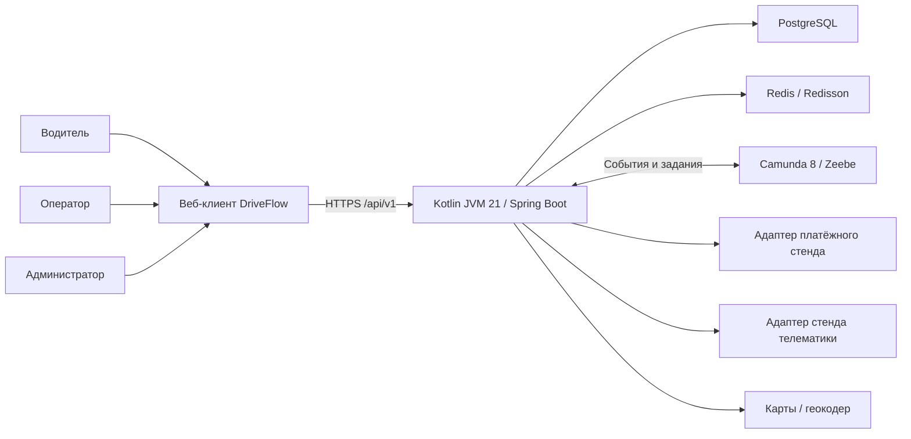

# Описание проектирования DriveFlow

Версия 0.1. Проект для обсуждения в рамках лабораторной работы № 4. Автор — Н.А. Михайлов.

## 1. Введение

DriveFlow — веб-система бронирования каршеринга. Она позволяет водителю найти и забронировать автомобиль, начать и завершить поездку, оплатить её и получить чек. Оператор разбирает спорные начисления, администратор управляет тарифами. SDD определяет компоненты, интерфейсы, данные и проверки, необходимые для выполнения [SRS версии 0.2](../srs/srs-template.md). План реализации приведён в [plan.md](../plan.md).

В учебном стенде платежи и команды автомобилю выполняются через адаптеры-заглушки. Страховые случаи, нативные приложения, ML-ценообразование и мультирегиональное развёртывание остаются за рамками проекта. Интервалы техобслуживания описаны как предлагаемое изменение CHG-001. Во время согласования его статус фиксируется в плане.

## 2. Обзор дизайна

| Участник | Задача | Представление |
|---|---|---|
| Водитель | Найти автомобиль, управлять бронью и поездкой, понять начисления | DF-01, DF-03, DF-04 |
| Оператор | Восстановить события и оформить перерасчёт или возврат | DF-02, DF-03, DF-04 |
| Администратор | Управлять тарифами и версиями | DF-02, DF-04 |
| Разработчик и тестировщик | Проверить транзакции, восстановление и ограничения качества | DF-02–DF-05 |

DF-01 показывает границы и внешние системы. DF-02 описывает компоненты и состояние данных. DF-03 показывает порядок выполнения команд. DF-04 описывает интерфейсы, DF-05 — развёртывание и методы проверки качества.

## 3. Проектные представления

### DF-01 Контекст системы

Проектное решение для веб-клиента — React и TypeScript. Клиент отображает серверное состояние и отправляет действия через API. Контроль ролей, расчёт суммы и проверка занятости выполняются на сервере.

### DF-02 Компоненты и данные

| Компонент | Ответственность | Данные |
|---|---|---|
| Catalog / BookingService | Поиск, бронь, освобождение интервала, отмена | Vehicle, Booking, VehicleOccupancy |
| TripOrchestrator | Переходы поездки, таймеры, задания адаптерам | Trip, OutboxEvent, ссылка на экземпляр BPMN |
| PricingEngine | Расчёт стоимости и управление версиями тарифов | TariffVersion, ChargeLine |
| PaymentAdapter | Предавторизация, списание, отмена, возврат и проверка результата | PaymentOperation |
| OperatorService / AuditLog | Спор, перерасчёт, разрешённые действия и журнал | Dispute, AuditEvent |
| ReceiptService | История, позиции расчёта и PDF-чек | Снимок тарифа, ChargeLine, статус платежа |

Бронь хранит владельца, автомобиль, интервал и снимок тарифа. Интервалы в PostgreSQL представлены диапазонами [начало, конец), время хранится в UTC и показывается в Europe/Minsk. Для действующей занятости ограничение по автомобилю и диапазону исключает пересечения. Соседние интервалы могут соприкасаться. Статус активной поездки проверяется отдельно при выдаче и активации. Журнал аудита содержит время, инициатора, старое и новое состояние и идентификатор корреляции.

### DF-03 Поведение и трассировка функций

| SDD | Источник SRS | Проектное поведение и проверка |
|---|---|---|
| SYS-F-001 | REQ-FUNC-001 | Поиск по интервалу и локации с сортировкой по расстоянию. Тест проверяет пустой результат и исключение занятых автомобилей. |
| SYS-F-002 | REQ-FUNC-002 | В одной транзакции создать бронь, занятость и аудит. Из 1000 конкурентных заявок одна успешна, остальные получают 409. |
| SYS-F-003 | REQ-FUNC-003 | Использовать таймаут из тарифа, по умолчанию 15 минут. Предупредить за 5 минут, перевести в EXPIRED, освободить интервал и отменить предавторизацию. Проверить истечение с точностью ±5 с и своевременность уведомления. |
| SYS-F-004 | REQ-FUNC-004 | Отменить бронь в RESERVED, освободить интервал и обработать предавторизацию. Удержать 2,00 BYN при отмене менее чем за 10 минут до начала по базовому тарифу. Повтор не меняет результат. |
| SYS-F-005 | REQ-FUNC-005 | Проверить права водителя, бронь и предавторизацию. При успешной разблокировке перевести поездку в ACTIVE. При отказе телематики сохранить RESERVED. |
| SYS-F-006 | REQ-FUNC-006 | Проверить парковочную зону и закрытие замков, зафиксировать FINISHING и рассчитать позиции. На 20 эталонных поездках проверяется точность расчёта до 0,01 BYN. |
| SYS-F-007 | REQ-FUNC-007 | Предавторизация при брони и списание после расчёта. Сто повторов одного запроса дают одно списание. Неиспользованный остаток предавторизации освобождается. |
| SYS-F-008 | REQ-FUNC-008 | При отказе отразить PAYMENT_FAILED. Для повторяемого сбоя использовать три попытки через 1, 5 и 15 минут. После исчерпания попыток создать задачу оператору. Проверить компенсации и отсутствие двойного списания. |
| SYS-F-009 | REQ-FUNC-009 | Оператор выполняет перерасчёт, частичный возврат или повтор списания с обязательным комментарием. Общий возврат ограничен списанной суммой. |
| SYS-F-010 | REQ-FUNC-010 | Записывать каждый переход и действия оператора. Тест проверяет восстановление истории и отсутствие операций редактирования или удаления журнала. |
| SYS-F-011 | REQ-FUNC-011 | Вывести историю, детализацию и чек PDF. Проверить права владельца и формирование чека не более чем за 5 с. |
| SYS-F-012 | REQ-FUNC-012 | Версионировать тарифы. Новая версия применяется к новым броням. Поездка использует условия, сохранённые при создании брони. |
| SYS-F-013, предложение | CHG-001 | Администратор задаёт будущий интервал обслуживания. Каталог исключает автомобиль на это время. Конфликт с действующей бронью возвращает 409. При гонке брони и обслуживания подтверждается только один запрос. |

Camunda 8 управляет таймерами и заданиями процесса. Изменение бизнес-состояния и событие outbox записываются в одной транзакции PostgreSQL. Доставка события допускает повтор, поэтому job workers проверяют состояние и идентификатор операции перед повтором внешнего действия. Подробности приведены в [ADR-0002](../docs/decisions/0002-orchestrate-trips-with-camunda.md) и [ADR-0003](../docs/decisions/0003-make-payment-operations-idempotent.md).

### DF-04 Интерфейсы

Все пути ниже приведены начиная с `/api/v1`.

| Метод и путь | Доступ и контракт |
|---|---|
| GET /vehicles | Водитель. Поиск по началу, концу и локации |
| POST /bookings | Водитель. Ключ Idempotency-Key. Ответ 409 при конфликте |
| POST /bookings/{id}/cancel | Владелец. Отмена из RESERVED |
| POST /bookings/{id}/activate | Владелец. Проверка прав, срока брони и результата предавторизации |
| POST /trips/{id}/finish | Владелец. Завершение активной поездки |
| GET /trips/{id}/receipt.pdf | Владелец. PDF по сохранённым позициям и данным платежа |
| POST /trips/{id}/disputes | Владелец. Открытие обращения по поездке |
| POST /disputes/{id}/refund | Оператор. Сумма возврата и комментарий обязательны |
| POST /tariffs | Администратор. Создание версии тарифа |
| POST /vehicles/{id}/maintenance | Администратор. Проект интерфейса CHG-001. Ответ 409 при конфликте |

Адаптер платёжного шлюза использует REST/JSON и таймаут 10 с. Адаптер телематики использует REST/JSON и таймаут 5 с. В системных данных хранится идентификатор токена провайдера, платёжные реквизиты остаются у шлюза. Права доступа обеспечиваются JWT, проверкой роли и владельца ресурса.

### DF-05 Развёртывание и атрибуты качества

| Источник | Проверка на этапе реализации |
|---|---|
| REQ-INT-001 | Проверка интерфейса от 360 px в последних двух версиях Chrome, Firefox, Edge и Safari. |
| REQ-PERF-001 | 200 запросов/с не менее 5 минут стационарной нагрузки на стенде 4 vCPU / 8 ГБ. p95 < 300 мс и ошибок не более 0,1 %. |
| REQ-REL-001 | Конкурентный тест с PostgreSQL и Redis в Testcontainers. При 1000 запросах нет пересекающихся подтверждённых броней. |
| REQ-REL-002 | Перезапуск сервиса на этапе платежа. Процесс возобновляется, повторное списание отсутствует. |
| REQ-SEC-001 | Тесты на 401, 403 и доступ только к своим данным. Проверка хранения секретов и отсутствия открытых паролей. |
| REQ-AVAIL-001 | Мониторинг доступности ключевого API за календарный месяц. Цель 99,5 % с исключением плановых работ в окне 03:00–05:00. |
| REQ-PORT-001 | Чистый запуск всех компонентов стенда через Docker Compose и проверка API. |

Сборка и запуск тестов выполняются через Gradle. Стенд включает приложение, PostgreSQL, Redis, Camunda 8 и заглушки интеграций. Миграции БД выполняет Flyway. Эти проверки запланированы для реализации.

## 4. Архитектурные решения

| Решение | Представление SDD |
|---|---|
| [ADR-0001 Согласованность бронирования](../docs/decisions/0001-enforce-booking-overlap-in-postgresql.md) | DF-02, DF-03 |
| [ADR-0002 Оркестрация поездки](../docs/decisions/0002-orchestrate-trips-with-camunda.md) | DF-02, DF-03 |
| [ADR-0003 Идемпотентные платежи](../docs/decisions/0003-make-payment-operations-idempotent.md) | DF-03, DF-04 |
| [ADR-0004 Снимок тарифа](../docs/decisions/0004-snapshot-tariff-on-booking.md) | DF-02, DF-03 |

## 5. Связанные материалы

- [Модель требований SysML v2](../srs/model/requirements.sysml).
- [План реализации и запрос CHG-001](../plan.md).
