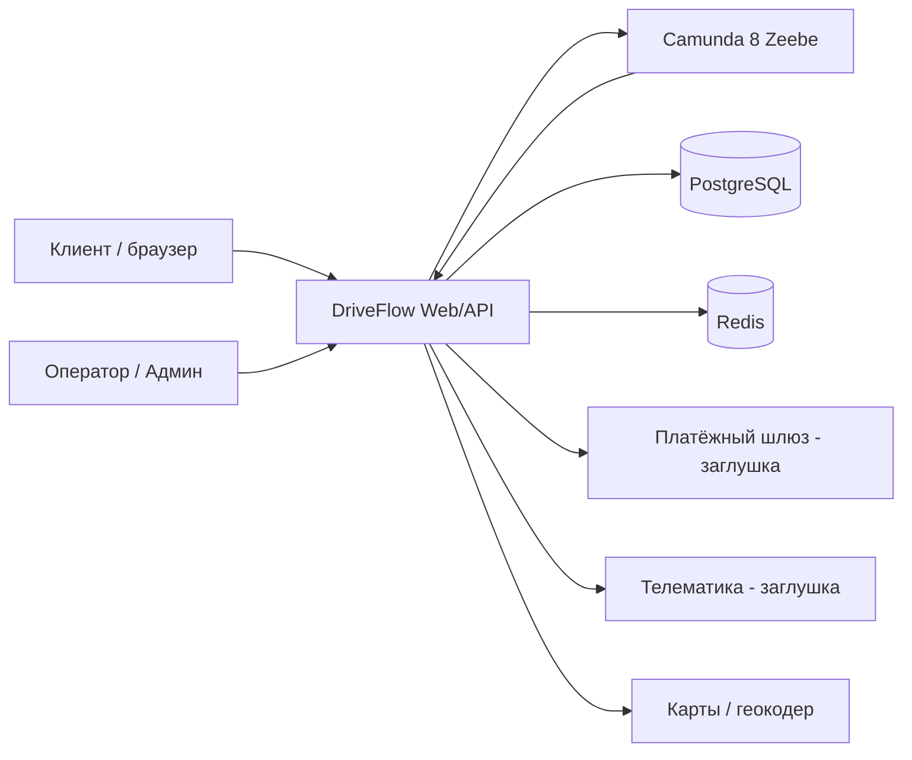
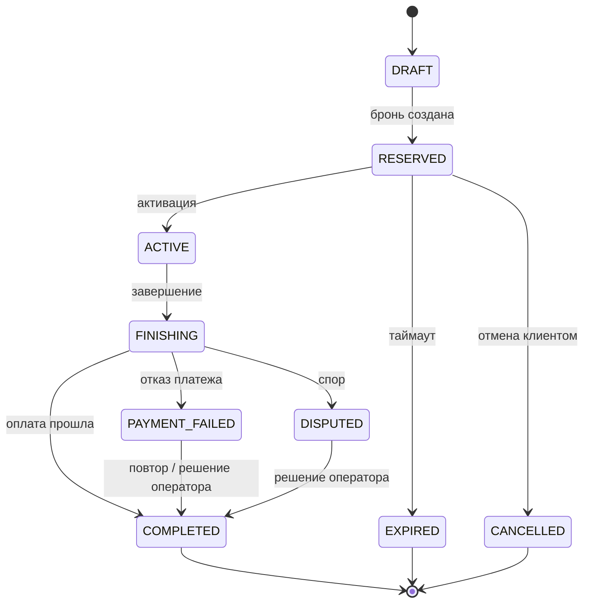

# Спецификация требований к ПО

Для DriveFlow — «Система бронирования каршеринга» (CarShare Booking Platform)

Версия 0.2

Подготовил Н.А. Михайлов

Кафедра ЭВМ, БГУИР

2026-10-19

## Оглавление

<!-- TOC -->
* [1. Введение](#1-introduction)
  * [1.1 Назначение документа](#11-document-purpose)
  * [1.2 Область применения продукта](#12-product-scope)
  * [1.3 Определения, акронимы и сокращения](#13-definitions-acronyms-and-abbreviations)
  * [1.4 Ссылки](#14-references)
  * [1.5 Обзор документа](#15-document-overview)
* [2. Обзор продукта](#2-product-overview)
  * [2.1 Перспектива продукта](#21-product-perspective)
  * [2.2 Функции продукта](#22-product-functions)
  * [2.3 Ограничения продукта](#23-product-constraints)
  * [2.4 Характеристики пользователей](#24-user-characteristics)
  * [2.5 Допущения и зависимости](#25-assumptions-and-dependencies)
  * [2.6 Распределение требований](#26-apportioning-of-requirements)
* [3. Требования](#3-requirements)
  * [3.1 Внешние интерфейсы](#31-external-interfaces)
    * [3.1.1 Пользовательские интерфейсы](#311-user-interfaces)
    * [3.1.2 Аппаратные интерфейсы](#312-hardware-interfaces)
    * [3.1.3 Программные интерфейсы](#313-software-interfaces)
  * [3.2 Функциональные требования](#32-functional)
  * [3.3 Качество обслуживания](#33-quality-of-service)
    * [3.3.1 Производительность](#331-performance)
    * [3.3.2 Безопасность](#332-security)
    * [3.3.3 Надёжность](#333-reliability)
    * [3.3.4 Доступность](#334-availability)
    * [3.3.5 Наблюдаемость](#335-observability)
  * [3.4 Соответствие стандартам](#34-compliance)
  * [3.5 Проектирование и реализация](#35-design-and-implementation)
    * [3.5.1 Установка](#351-installation)
    * [3.5.2 Сборка и поставка](#352-build-and-delivery)
    * [3.5.3 Распределение](#353-distribution)
    * [3.5.4 Сопровождаемость](#354-maintainability)
    * [3.5.5 Повторное использование](#355-reusability)
    * [3.5.6 Переносимость](#356-portability)
    * [3.5.7 Стоимость](#357-cost)
    * [3.5.8 Сроки](#358-deadline)
    * [3.5.9 Доказательство концепции](#359-proof-of-concept)
    * [3.5.10 Управление изменениями](#3510-change-management)
  * [3.6 ИИ/МО](#36-aiml)
* [4. Верификация](#4-verification)
* [5. Приложения](#5-appendixes)
<!-- TOC -->

## История изменений

| Name | Date | Reason For Changes | Version |
|------|------|--------------------|---------|
| Н.А. Михайлов | 2026-10-19 | Первая редакция SRS на основе интервью с Заказчиком (В.А. Сыман) | 0.1 |
| Н.А. Михайлов | 2026-10-19 | Учтены замечания Заказчика из Pull Request: настраиваемый таймаут брони и уведомление (REQ-FUNC-003), частичный возврат (REQ-FUNC-009), чек в PDF (REQ-FUNC-011). Предложение о динамическом ценообразовании отклонено (перенесено в Won’t) | 0.2 |

---

## 1. Введение {#1-introduction}

Документ описывает требования к веб-системе бронирования каршеринга DriveFlow, которая управляет жизненным циклом поездки: от брони автомобиля до расчёта и списания стоимости. Документ разработан по шаблону кафедры ЭВМ БГУИР в соответствии с ISO/IEC/IEEE 29148:2018 и IEEE 830-1998.

### 1.1 Назначение документа {#11-document-purpose}

SRS фиксирует соглашение между Заказчиком (оператором каршеринга) и командой разработки о том, **ЧТО** должна делать система, без описания того, КАК это будет реализовано. Документом пользуются: Заказчик (приёмка и согласование), разработчики (проектирование и реализация), QA (составление тестов и матрица верификации), преподаватель (проверка в рамках курса ЖЦРПО). Связанные документы: SDD (проектирование архитектуры, следующая лабораторная работа) и записи ADR о значимых решениях.

### 1.2 Область применения продукта {#12-product-scope}

Продукт: **DriveFlow** (Система бронирования каршеринга), версия 0.x (учебный проект на весь курс). Система позволяет клиентам искать и бронировать автомобили, проходит поездку через формализованный жизненный цикл (бронь, активация, поездка, завершение, расчёт, оплата) и даёт оператору инструменты разбора спорных случаев и аудита.

Бизнес-цели (выявлены на интервью): исключить двойные брони одного автомобиля; сократить долю спорных списаний; автоматизировать завершение поездки и расчёт стоимости; обеспечить аудит каждого шага жизненного цикла.

**Входит в границы (In-Scope):**
1. каталог доступных автомобилей и поиск по времени и локации;
2. бронирование на интервал без конфликтов при параллельных запросах;
3. оркестрация жизненного цикла поездки;
4. расчёт стоимости по тарифу (поминутно, за километр, стоянка, ночной коэффициент, штрафы, промокод);
5. предавторизация и списание средств через платёжный шлюз с идемпотентностью;
6. журнал аудита поездки и история поездок клиента;
7. рабочее место оператора: разбор спорных поездок и перерасчёт.

**Не входит (Out-of-Scope):** мобильные нативные приложения; реальная интеграция с телематикой конкретного производителя (используется заглушка); страхование и урегулирование ДТП; динамическое ценообразование на основе ML; мультирегиональное развёртывание.

**Приоритизация (MoSCoW):** Must — бронирование без двойных броней, расчёт стоимости, оплата; Should — разбор споров оператором, отмена со штрафом; Could — промокоды, уведомления; Won’t — ML-ценообразование.

### 1.3 Определения, акронимы и сокращения {#13-definitions-acronyms-and-abbreviations}

| Term | Definition |
|------|------------|
| API | Application Programming Interface — набор определений и протоколов для интеграции прикладного ПО |
| ADR | Architecture Decision Record — запись об архитектурном решении |
| BPMN | Business Process Model and Notation — нотация моделирования бизнес-процессов |
| Camunda 8 (Zeebe) | Платформа оркестрации бизнес-процессов, исполняющая BPMN-модели |
| Idempotency-Key | Уникальный ключ запроса, гарантирующий, что повтор не приведёт к повторному действию |
| MoSCoW | Метод приоритизации: Must, Should, Could, Won’t |
| p95 | 95-й процентиль времени ответа |
| RBAC | Role-Based Access Control — управление доступом на основе ролей |
| Saga | Паттерн согласованности: последовательность шагов с компенсирующими действиями при сбое |
| SRS | Software Requirements Specification — спецификация требований к ПО |
| SysML v2 | Systems Modeling Language v2 — язык моделирования систем |
| UI | User Interface — пользовательский интерфейс |
| Бронь | Резервирование автомобиля за клиентом на интервал времени |
| Поездка | Сущность жизненного цикла: от создания брони до завершения оплаты |
| Предавторизация | Блокировка суммы на карте клиента без списания |

### 1.4 Ссылки {#14-references}

| № | Источник | Версия / дата | Тип |
|---|----------|---------------|-----|
| 1 | ISO/IEC/IEEE 29148:2018, Systems and software engineering — Requirements engineering | 2018 | Нормативная |
| 2 | IEEE 830-1998, Recommended Practice for SRS | 1998 | Справочная |
| 3 | Шаблон SRS кафедры ЭВМ БГУИР (srs/srs-template.md) | — | Нормативная |
| 4 | Модель требований SysML v2: srs/model/requirements.sysml | 0.2 | Справочная |
| 5 | GUI-мокапы: srs/img/ | 0.2 | Справочная |
| 6 | Репозиторий проекта: https://github.com/alnitmit/SDLC | — | Справочная |

### 1.5 Обзор документа {#15-document-overview}

Раздел 2 описывает контекст продукта, пользователей и ограничения. Раздел 3 содержит верифицируемые требования: интерфейсы, функциональные требования REQ-FUNC-001…012, атрибуты качества (PERF, SEC, REL, AVAIL, PORT) и ограничения проектирования. Раздел 4 — матрица верификации, раздел 5 — приложения (диаграмма и жизненный цикл). Все требования имеют идентификатор вида `REQ-[AREA]-[NNN]`; идентификаторы неизменяемы, изменения фиксируются в истории изменений.

---

## 2. Обзор продукта {#2-product-overview}

### 2.1 Перспектива продукта {#21-product-perspective}

DriveFlow — новый самостоятельный продукт (учебный проект), в котором логика бронирования и расчёта отделена от внешних сервисов. Система взаимодействует с внешними системами: платёжным шлюзом (предавторизация и списание), телематикой автомобиля (открыть/закрыть замок, телеметрия), сервисом карт и геокодирования. На время курса эти сервисы заменены заглушками (mock-серверами). Владелец продукта — оператор каршеринга (Заказчик).

### 2.2 Функции продукта {#22-product-functions}

1. Поиск свободных автомобилей по времени и локации.
2. Бронирование без пересечений интервалов, автоматическое истечение и отмена брони.
3. Активация поездки и управление замками автомобиля.
4. Завершение поездки и расчёт стоимости по тарифу.
5. Предавторизация, списание, повтор списания и компенсации при сбоях.
6. Журнал аудита и история поездок клиента, электронный чек.
7. Рабочее место оператора: спорные поездки, перерасчёт, частичный возврат.
8. Управление тарифами (администратор).

### 2.3 Ограничения продукта {#23-product-constraints}

- Система должна быть реализована на языке Kotlin (JVM 21) с использованием Spring Boot 3.
- Оркестрация жизненного цикла поездки должна выполняться в Camunda 8 (BPMN 2.0), шаги выполняют job workers на Kotlin.
- Данные должны храниться в PostgreSQL; миграции схемы выполняет Flyway; Redis используется для распределённых блокировок и кэша.
- Денежные суммы должны храниться и вычисляться в типе `BigDecimal` (или в минорных единицах), без использования типов с плавающей точкой.
- Окружение разработки и тестирования должно запускаться через Docker Compose; интеграционные тесты должны использовать Testcontainers.
- Внешние сервисы (платёж, телематика) на время курса реализуются заглушками.

### 2.4 Характеристики пользователей {#24-user-characteristics}

| Класс | Цели | Подготовка / доступ | Частота |
|-------|------|---------------------|---------|
| Клиент (водитель) | Быстро забронировать авто, начать и завершить поездку, видеть стоимость | Обычный пользователь веба на ПК и смартфоне, без специальной подготовки | Несколько раз в неделю |
| Оператор поддержки | Разбирать спорные поездки и неудачные списания | Обучен работе с панелью оператора, расширенные права на чтение и корректировку | Ежедневно |
| Администратор парка | Управлять тарифами и автомобилями | Высокий уровень доступа, технически подготовлен | Редко |
| Внешняя система биллинга | Принимать запросы на предавторизацию и списание | Программный интегратор, доступ по API | Постоянно |

Интерфейс должен быть на русском языке; сроки и суммы отображаются в формате региона (BYN, часовой пояс Europe/Minsk).

### 2.5 Допущения и зависимости {#25-assumptions-and-dependencies}

| № | Допущение / зависимость | Влияние, если неверно |
|---|------------------------|-----------------------|
| 1 | Платёжный шлюз поддерживает предавторизацию и идемпотентные запросы (Idempotency-Key) | Потребуется собственный слой дедупликации платежей |
| 2 | Телематика автомобиля отвечает на команды открыть/закрыть замок за ≤ 5 с | Нужны таймауты и ручной сценарий активации |
| 3 | Camunda 8 (Zeebe) доступна в окружении проекта | Возврат к оркестрации в коде, пересмотр REQ-REL-002 |
| 4 | Часы серверов синхронизированы (NTP) | Некорректное истечение броней и расчёт времени |
| 5 | Заказчик участвует в приёмке и ревью в Pull Request | Рост риска расхождения требований |

### 2.6 Распределение требований {#26-apportioning-of-requirements}

| Требования | Компонент | Инкремент |
|------------|-----------|-----------|
| REQ-FUNC-001, 002, 003, 004 | BookingService | 1 (MVP) |
| REQ-FUNC-005, 006 | TripOrchestrator (Camunda), PricingEngine | 1 (MVP) |
| REQ-FUNC-007, 008 | PaymentAdapter | 2 |
| REQ-FUNC-009, 010, 011 | OperatorService, AuditLog, ReceiptService | 2 |
| REQ-FUNC-012 | PricingEngine (тарифы) | 3 |
| REQ-PERF-001, REQ-REL-001, REQ-REL-002 | BookingService, Camunda | 1–2 |
| REQ-SEC-001, REQ-AVAIL-001, REQ-PORT-001 | Платформа, инфраструктура | 1–3 |

---

## 3. Требования {#3-requirements}

Формат требований: ID, Title, Statement, Rationale, Acceptance Criteria, Verification Method, More Information. Формат ID: `REQ-[AREA]-[NNN]`. Нормативные слова: «должна» — обязательное, «следует» — рекомендуемое.

### 3.1 Внешние интерфейсы {#31-external-interfaces}

#### 3.1.1 Пользовательские интерфейсы {#311-user-interfaces}

Веб-интерфейс (React + TypeScript либо серверный рендеринг, окончательный выбор фиксируется в SDD) состоит из экранов, показанных на мокапах:

| Экран | Мокап | Связанные требования |
|-------|-------|----------------------|
| Поиск и каталог автомобилей |  | REQ-FUNC-001 |
| Бронь автомобиля |  | REQ-FUNC-002, 003, 004, 005 |
| Активная поездка |  | REQ-FUNC-005, 006 |
| Итоги поездки и чек |  | REQ-FUNC-006, 007, 011 |
| Панель оператора |  | REQ-FUNC-008, 009, 010 |

**REQ-INT-001.** Интерфейс должен быть доступен в современных браузерах (Chrome, Firefox, Edge, Safari — две последние версии) и корректно отображаться на ширине экрана от 360 px. *Верификация: Demonstration.*

#### 3.1.2 Аппаратные интерфейсы {#312-hardware-interfaces}

Прямые аппаратные интерфейсы отсутствуют. Взаимодействие с оборудованием автомобиля (замки, телеметрия) осуществляется только через программный интерфейс телематики (3.1.3).

#### 3.1.3 Программные интерфейсы {#313-software-interfaces}

| Система | Назначение | Протокол / стиль | Примечания |
|---------|-----------|------------------|------------|
| Платёжный шлюз (заглушка) | Предавторизация, списание, возврат | REST/JSON, заголовок Idempotency-Key | Аутентификация по API-ключу; таймаут 10 с; ретраи по REQ-FUNC-008 |
| Телематика автомобиля (заглушка) | Открыть/закрыть замок, телеметрия (пробег, топливо, координаты) | REST/JSON | Таймаут 5 с; ошибка не должна приводить к потере брони |
| Карты / геокодер | Отображение карты, поиск по адресу | REST/JSON | Лимиты запросов учитываются в кэше |
| Camunda 8 (Zeebe) | Исполнение BPMN-процесса поездки | gRPC (клиент Zeebe) | Версионирование BPMN-моделей |
| PostgreSQL | Основное хранилище | JDBC | Миграции Flyway |
| Redis | Распределённые блокировки, кэш | Redis protocol | Блокировки с TTL |

REST API системы должен версионироваться в пути (`/api/v1/...`).

### 3.2 Функциональные требования {#32-functional}

#### REQ-FUNC-001 — Поиск свободных автомобилей
- **Statement:** Система должна отображать клиенту автомобили, свободные на выбранный интервал и находящиеся в заданной локации, с моделью, уровнем топлива, расстоянием и тарифом.
- **Rationale:** Клиент должен быстро найти подходящий автомобиль; снижает количество неудачных броней.
- **Acceptance Criteria:** в выдаче нет автомобилей с пересекающейся бронью или поездкой; результат отсортирован по расстоянию; при отсутствии автомобилей показывается пустое состояние с подсказкой.
- **Verification Method:** Test.
- **More Information:** мокап рис. 3.2; приоритет Must.

#### REQ-FUNC-002 — Бронирование без пересечений интервалов
- **Statement:** Система должна создавать бронь автомобиля на интервал времени и отклонять запрос, если интервал пересекается с активной бронью или поездкой этого автомобиля.
- **Rationale:** Исключение двойных броней — главная бизнес-цель Заказчика.
- **Acceptance Criteria:** при 1000 одновременных запросов на один автомобиль и один интервал успешным является ровно один, остальные получают ответ 409; пересечение невозможно на уровне БД (ограничение `EXCLUDE USING gist` по диапазону времени); бронь получает состояние RESERVED и запись в журнале аудита.
- **Verification Method:** Test (конкурентный, Testcontainers).
- **More Information:** защита в три уровня: распределённая блокировка Redisson, блокировка строки `SELECT … FOR UPDATE`, ограничение БД; приоритет Must.

#### REQ-FUNC-003 — Истечение брони и уведомление
- **Statement:** Система должна автоматически переводить бронь из RESERVED в EXPIRED и освобождать автомобиль, если поездка не активирована за время ожидания. Время ожидания должно настраиваться по типу тарифа (по умолчанию 15 минут). За 5 минут до истечения клиенту должно отправляться уведомление.
- **Rationale:** Автомобиль не должен простаивать без пользы; клиент не должен терять бронь неожиданно (замечание Заказчика, версия 0.2).
- **Acceptance Criteria:** истечение срабатывает с точностью ±5 с; после EXPIRED автомобиль доступен для поиска; предавторизация отменяется; уведомление отправлено не позднее чем за 4 минуты 50 секунд до истечения; изменение таймаута тарифа применяется к новым броням.
- **Verification Method:** Test (с управляемыми часами).
- **More Information:** реализуется таймером в BPMN-процессе; приоритет Must.

#### REQ-FUNC-004 — Отмена брони клиентом
- **Statement:** Система должна позволять клиенту отменить бронь в состоянии RESERVED, освободить автомобиль, отменить предавторизацию и удержать комиссию 2,00 BYN, если отмена выполнена менее чем за 10 минут до начала интервала.
- **Rationale:** Гибкость для клиента и компенсация оператору за поздние отмены.
- **Acceptance Criteria:** состояние CANCELLED; комиссия удерживается только по условию; повторная отмена не меняет результат; запись в журнале аудита.
- **Verification Method:** Test.
- **More Information:** размер комиссии берётся из тарифа; приоритет Should.

#### REQ-FUNC-005 — Активация поездки
- **Statement:** Система должна активировать поездку только после проверки действительности прав водителя и состояния брони и должна отправить команду разблокировки автомобиля.
- **Rationale:** Нельзя выдавать автомобиль водителю без прав или по недействительной брони.
- **Acceptance Criteria:** при успехе состояние ACTIVE; при отказе телематики состояние остаётся RESERVED, клиент получает сообщение и может повторить; команда не отправляется повторно без запроса.
- **Verification Method:** Test, Demonstration.
- **More Information:** мокапы рис. 3.3, 3.4; приоритет Must.

#### REQ-FUNC-006 — Завершение поездки и расчёт стоимости
- **Statement:** Система должна при завершении поездки проверить закрытие замков и допустимую зону парковки, перевести поездку в FINISHING и рассчитать стоимость по тарифу: время + пробег + стоянка + штрафы − скидка по промокоду, с учётом ночного коэффициента.
- **Rationale:** Автоматический и прозрачный расчёт сокращает спорные списания.
- **Acceptance Criteria:** на 20 эталонных поездках расчёт совпадает с ожидаемым значением до 0,01 BYN; результат округляется до 0,01 BYN; применённая версия тарифа сохраняется в чеке; разбивка стоимости доступна клиенту.
- **Verification Method:** Test.
- **More Information:** вычисления в `BigDecimal`; приоритет Must.

#### REQ-FUNC-007 — Предавторизация и списание с идемпотентностью
- **Statement:** Система должна выполнять предавторизацию при создании брони и списание при завершении поездки, передавая в платёжный шлюз Idempotency-Key. Повторный запрос с тем же ключом не должен приводить к повторному списанию.
- **Rationale:** Исключение двойных списаний при сетевых сбоях и повторах.
- **Acceptance Criteria:** 100 повторов одного запроса приводят к одному списанию; неиспользованная часть предавторизации разблокируется; статус платежа сохраняется в БД.
- **Verification Method:** Test.
- **More Information:** приоритет Must.

#### REQ-FUNC-008 — Повтор списания и компенсации (saga)
- **Statement:** Система должна при отказе платежа переводить поездку в PAYMENT_FAILED, повторять списание до 3 раз с растущей задержкой (1, 5 и 15 минут), после чего создавать задачу оператору. При сбое шага процесса система должна выполнять компенсирующие действия (снять блокировку автомобиля, отменить предавторизацию).
- **Rationale:** Минимизация потерь выручки и согласованность данных при частичных сбоях.
- **Acceptance Criteria:** после третьей неудачи создана задача оператору; компенсации не оставляют заблокированных автомобилей и «висящих» предавторизаций; повторы не создают двойных списаний.
- **Verification Method:** Test.
- **More Information:** реализуется в BPMN с компенсирующими событиями; приоритет Should.

#### REQ-FUNC-009 — Разбор спорных поездок оператором
- **Statement:** Система должна предоставлять оператору список поездок в состояниях DISPUTED и PAYMENT_FAILED и действия «Пересчитать», «Частичный возврат» и «Повторить списание». Каждое действие должно требовать комментарий и фиксироваться в журнале аудита.
- **Rationale:** Сокращение доли спорных списаний и времени их обработки (замечание Заказчика: частичный возврат, версия 0.2).
- **Acceptance Criteria:** действия доступны только роли оператора; сумма частичного возврата не превышает списанную; результат отражается в чеке клиента.
- **Verification Method:** Demonstration, Test.
- **More Information:** мокап рис. 3.6; приоритет Should.

#### REQ-FUNC-010 — Журнал аудита
- **Statement:** Система должна записывать каждый переход состояния поездки с временем (UTC), прежним и новым состоянием, инициатором и идентификатором корреляции. Записи журнала должны быть доступны только для добавления и чтения.
- **Rationale:** Прозрачность и доказательная база при спорах.
- **Acceptance Criteria:** 100% переходов имеют запись; изменение или удаление записи через интерфейс невозможно; оператор может просмотреть журнал поездки.
- **Verification Method:** Inspection, Test.
- **More Information:** приоритет Must.

#### REQ-FUNC-011 — История поездок и электронный чек
- **Statement:** Система должна показывать клиенту историю его поездок с детальной разбивкой стоимости и должна позволять скачать чек в формате PDF.
- **Rationale:** Прозрачность для клиента; снижение числа обращений (замечание Заказчика: PDF, версия 0.2).
- **Acceptance Criteria:** чек содержит все компоненты стоимости и статус платежа; PDF формируется не более чем за 5 секунд; клиент видит только свои поездки.
- **Verification Method:** Test.
- **More Information:** мокап рис. 3.5; приоритет Should.

#### REQ-FUNC-012 — Управление тарифами
- **Statement:** Система должна позволять администратору создавать и изменять тарифы с версионированием; поездка должна использовать версию тарифа, действовавшую на момент создания брони.
- **Rationale:** Изменение цен не должно влиять на уже созданные брони.
- **Acceptance Criteria:** при изменении тарифа существующие брони сохраняют прежние условия; история версий доступна администратору.
- **Verification Method:** Test.
- **More Information:** приоритет Could.

### 3.3 Качество обслуживания {#33-quality-of-service}

#### 3.3.1 Производительность {#331-performance}

**REQ-PERF-001 — Время создания брони.** Система должна создавать бронь с задержкой p95 менее 300 мс при нагрузке 200 запросов в секунду. *Критерий приёмки:* нагрузочный тест на стенде 4 vCPU / 8 ГБ ОЗУ, не менее 5 минут стационарной нагрузки, ошибок не более 0,1%. *Верификация:* Test (нагрузочный).

#### 3.3.2 Безопасность {#332-security}

**REQ-SEC-001 — Аутентификация и роли.** Система должна выполнять аутентификацию через JWT и разграничивать доступ по ролям (клиент, оператор, администратор). *Критерий приёмки:* запрос без токена получает 401; запрос с недостаточной ролью получает 403; клиент не может получить чужие поездки; пароли и секреты не хранятся в открытом виде. *Верификация:* Test, Inspection.

#### 3.3.3 Надёжность {#333-reliability}

**REQ-REL-001 — Отсутствие дублей брони.** Система должна гарантировать отсутствие пересекающихся броней одного автомобиля при 1000 конкурентных запросах. *Критерий приёмки:* автоматический конкурентный тест не обнаруживает ни одной пересекающейся пары броней. *Верификация:* Test (Testcontainers).

**REQ-REL-002 — Сохранение состояния процесса.** Состояние процесса поездки должно сохраняться при перезапуске сервиса. *Критерий приёмки:* после перезапуска сервиса в середине процесса поездка продолжается с того же шага без потери данных и без повторных списаний. *Верификация:* Test.

#### 3.3.4 Доступность {#334-availability}

**REQ-AVAIL-001 — Целевая доступность.** Система должна быть доступна не менее 99,5% времени в месяц (не более примерно 3 ч 40 мин простоя), за исключением плановых работ в окне 03:00–05:00. *Верификация:* Analysis (мониторинг).

#### 3.3.5 Наблюдаемость {#335-observability}

Отдельные требования наблюдаемости на данном этапе не заявлены. Базовое структурированное логирование с идентификатором корреляции должно использоваться в рамках REQ-FUNC-010; детальные требования (метрики, трассировки) будут добавлены на этапе проектирования.

### 3.4 Соответствие стандартам {#34-compliance}

Нормативные требования предметной области (платёжные стандарты, персональные данные) на уровне учебного проекта не заявляются. Хранение платёжных данных на стороне системы не допускается: используется токенизация шлюза.

### 3.5 Проектирование и реализация {#35-design-and-implementation}

#### 3.5.1 Установка {#351-installation}
Все компоненты (приложение, PostgreSQL, Redis, Camunda 8) должны запускаться одной командой через Docker Compose. Конфигурация и секреты передаются через переменные окружения.

#### 3.5.2 Сборка и поставка {#352-build-and-delivery}
Сборка выполняется Gradle (Kotlin DSL); CI (GitHub Actions) запускает сборку и тесты при каждом Pull Request.

#### 3.5.3 Распределение {#353-distribution}
Система разворачивается в одном регионе; приложение должно допускать запуск нескольких экземпляров без нарушения REQ-REL-001 (общие блокировки через Redis и БД).

#### 3.5.4 Сопровождаемость {#354-maintainability}
Код должен быть разделён на модули по границам сервисов (BookingService, PricingEngine, PaymentAdapter, TripOrchestrator); бизнес-логика не должна зависеть от UI и инфраструктуры. Покрытие тестами ключевых сценариев (бронь, расчёт, платёж) обязательно.

#### 3.5.5 Повторное использование {#355-reusability}
Расчёт стоимости и адаптер платежа должны быть выделены как независимые компоненты с чёткими интерфейсами.

#### 3.5.6 Переносимость {#356-portability}
**REQ-PORT-001 — Запуск через Docker Compose.** Система должна запускаться в любом окружении с Docker без дополнительной ручной настройки, кроме переменных окружения. *Верификация:* Demonstration.

#### 3.5.7 Стоимость {#357-cost}
Проект учебный: используются только бесплатные и открытые компоненты.

#### 3.5.8 Сроки {#358-deadline}
Сроки определяются графиком курса ЖЦРПО; требования распределены по трём инкрементам (раздел 2.6).

#### 3.5.9 Доказательство концепции {#359-proof-of-concept}
Перед реализацией следует выполнить PoC: параллельное бронирование (1000 запросов) с блокировками Redisson и ограничением `EXCLUDE USING gist`; цель — подтвердить REQ-REL-001 и REQ-PERF-001.

#### 3.5.10 Управление изменениями {#3510-change-management}
Изменения требований вносятся через Pull Request с обязательным ревью Заказчика; для каждого изменения указывается влияние на сроки, архитектуру и тесты; версия SRS и история изменений обновляются в каждом принятом Pull Request. Отклонённые замечания фиксируются с обоснованием.

### 3.6 ИИ/МО {#36-aiml}

Не применимо: продукт не содержит компонентов машинного обучения. Динамическое ценообразование на основе ML исключено из границ проекта (Won’t).

---

## 4. Верификация {#4-verification}

| Requirement ID | Verification Method | Test/Artifact Link | Status | Evidence |
|----------------|---------------------|--------------------|--------|----------|
| REQ-FUNC-001 | Test | tests/search/SearchAvailabilityTest | Planned | |
| REQ-FUNC-002 | Test | tests/booking/ConcurrentBookingTest | Planned | |
| REQ-FUNC-003 | Test | tests/booking/ReservationExpiryTest | Planned | |
| REQ-FUNC-004 | Test | tests/booking/CancelBookingTest | Planned | |
| REQ-FUNC-005 | Test, Demonstration | tests/trip/ActivateTripTest | Planned | |
| REQ-FUNC-006 | Test | tests/pricing/PricingGoldenTest | Planned | |
| REQ-FUNC-007 | Test | tests/payment/IdempotentPaymentTest | Planned | |
| REQ-FUNC-008 | Test | tests/payment/RetryAndCompensationTest | Planned | |
| REQ-FUNC-009 | Demonstration, Test | tests/operator/DisputeFlowTest | Planned | |
| REQ-FUNC-010 | Inspection, Test | tests/audit/AuditLogTest | Planned | |
| REQ-FUNC-011 | Test | tests/receipt/ReceiptPdfTest | Planned | |
| REQ-FUNC-012 | Test | tests/pricing/TariffVersioningTest | Planned | |
| REQ-INT-001 | Demonstration | docs/browser-matrix.md | Planned | |
| REQ-PERF-001 | Test (нагрузочный) | tests/perf/BookingLoadTest | Planned | |
| REQ-SEC-001 | Test, Inspection | tests/security/AuthRolesTest | Planned | |
| REQ-REL-001 | Test | tests/booking/ConcurrentBookingTest | Planned | |
| REQ-REL-002 | Test | tests/trip/ProcessRestartTest | Planned | |
| REQ-AVAIL-001 | Analysis | docs/availability-analysis.md | Planned | |
| REQ-PORT-001 | Demonstration | docker-compose.yml | Planned | |

Тесты включают позитивные и негативные сценарии; интеграционные тесты используют Testcontainers (PostgreSQL, Redis). Ссылки на тесты будут уточнены на этапе реализации.

---

## 5. Приложения {#5-appendixes}

### Приложение A. Диаграмма требований и трассируемости (SysML v2)

Исходный текст модели: [model/requirements.sysml](model/requirements.sysml).

### Приложение B. Жизненный цикл поездки

